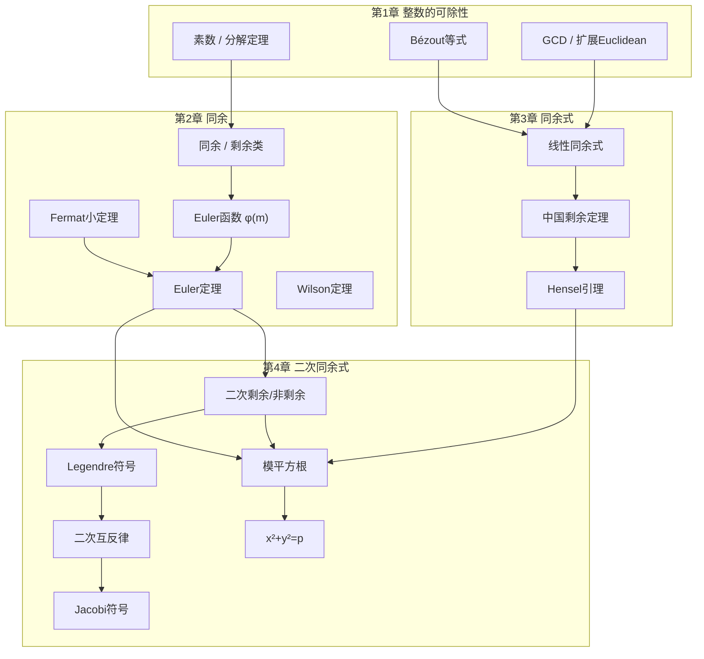

# 信息安全数学基础 -- 第1至4章 课程梳理

> [!info] 课程信息
> **教材**: 信息安全数学基础（第2版） -- 陈恭亮
> **Update**:2026-10-14

---

## 课程总览与学习路线

| 章节 | 核心主题 | 难度 | 前置知识 | 预计学时 |
|------|----------|------|----------|----------|
| 第1章 | 整除性、素数、GCD、Euclidean算法 | 基础 | 高中数学 | 8h |
| 第2章 | 同余理论、剩余类、Euler定理 | 中等 | 第1章 | 10h |
| 第3章 | 同余方程、CRT、Hensel引理 | 中高 | 第1-2章 | 10h |
| 第4章 | 二次剩余、Legendre符号、二次互反律 | 较高 | 第1-3章 | 12h |

> [!tip] 学习建议
> 1. **第1章**是后续所有章节的基石，务必熟练掌握辗转相除法和扩展Euclidean算法
> 2. **第2章**引入同余语言，是整个数论的核心工具，需深入理解剩余类的概念
> 3. **第3章**将同余转化为方程求解，CRT和Hensel引理是密码学中的重要工具
> 4. **第4章**综合前三章知识，二次剩余理论在公钥密码（如Rabin体制）中有直接应用

---

# 第1章 整数的可除性

## 1.1 整除与Euclidean除法

### 1.1.1 整除的基本概念

> [!definition] 整除
> 设 $a, b$ 是整数，$b \neq 0$。如果存在整数 $q$ 使得 $a = bq$，则称 $b$ **整除** $a$，记为 $b \mid a$。
> 此时称 $b$ 为 $a$ 的**因数**（或**除数**），$a$ 为 $b$ 的**倍数**。

> [!note] 整除的基本性质
> 1. 若 $b \mid a$，则 $b \mid (-a)$，且 $|b| \leq |a|$（当 $a \neq 0$ 时）
> 2. 若 $b \mid a$ 且 $c \mid b$，则 $c \mid a$（传递性）
> 3. 若 $c \mid a$ 且 $c \mid b$，则 $c \mid (a \pm b)$
> 4. 若 $c \mid a$，则对任意整数 $b$，$c \mid ab$
> 5. $1 \mid a$，$a \mid a$，$a \mid 0$

### 1.1.2 Euclidean除法（带余除法）

> [!theorem] Euclidean除法定理
> 设 $a, b$ 是整数，$b > 0$，则存在唯一的整数 $q$（商）和 $r$（余数）使得：
> $$a = bq + r, \quad 0 \leq r < b$$

> [!example] 例1.1.1
> $a = 99, b = 5$: $99 = 5 \times 19 + 4$，商 $q = 19$，余数 $r = 4$。

> [!definition] 最大公因数
> 设 $a, b$ 是不全为零的整数。$a, b$ 的**最大公因数**（GCD）是能整除 $a$ 和 $b$ 的最大正整数，记为 $(a, b)$ 或 $\gcd(a, b)$。

---

## 1.2 素数与Eratosthenes筛法

### 1.2.1 素数的基本概念

> [!definition] 素数与合数
> 设 $p > 1$ 是整数。如果 $p$ 的正因数只有 $1$ 和 $p$，则称 $p$ 为**素数**（或**质数**）。
> 如果 $p > 1$ 且不是素数，则称 $p$ 为**合数**。

> [!note] 素数的基本性质
> - $2$ 是唯一的偶素数
> - 素数有无穷多个（Euclid证明）
> - 若 $p \mid ab$，则 $p \mid a$ 或 $p \mid b$（Euclid引理）

### 1.2.2 Eratosthenes筛法

> [!algorithm] Eratosthenes筛法
> **目标**: 找出 $\leq N$ 的所有素数
> **步骤**:
> 1. 写出 $2, 3, 4, \dots, N$
> 2. 找到最小的未被标记的数 $p$，它是素数
> 3. 标记 $p^2, p^2 + p, p^2 + 2p, \dots$ 为合数
> 4. 重复步骤2-3，直到 $p > \sqrt{N}$
> 5. 所有未被标记的数即为素数

> [!tip] 应用
> Eratosthenes筛法适用于找出较小范围内的所有素数，时间复杂度约为 $O(N \log \log N)$。

---

## 1.3 Euclidean算法与扩展Euclidean算法

### 1.3.1 辗转相除法（Euclidean算法）

> [!theorem] Euclidean算法
> 设 $a, b$ 是正整数，$a > b$。通过连续除法：
> $$\begin{aligned}
> a &= bq_1 + r_1, \quad 0 < r_1 < b \\
> b &= r_1 q_2 + r_2, \quad 0 < r_2 < r_1 \\
> r_1 &= r_2 q_3 + r_3, \quad 0 < r_3 < r_2 \\
> &\;\;\vdots \\
> r_{n-2} &= r_{n-1} q_n + r_n, \quad 0 < r_n < r_{n-1} \\
> r_{n-1} &= r_n q_{n+1} + 0
> \end{aligned}$$
> 则 $(a, b) = r_n$（最后一个非零余数）。

> [!important] 关键性质
> 在辗转相除过程中：$(a, b) = (b, r_1) = (r_1, r_2) = \cdots = (r_{n-1}, r_n) = r_n$

> [!example] 例: 求 $(288, 123)$
> $$\begin{aligned}
> 288 &= 123 \times 2 + 42 \\
> 123 &= 42 \times 2 + 39 \\
> 42 &= 39 \times 1 + 3 \\
> 39 &= 3 \times 13 + 0
> \end{aligned}$$
> 所以 $(288, 123) = 3$。

### 1.3.2 扩展Euclidean算法（Bézout等式）

> [!theorem] Bézout定理
> 设 $a, b$ 是不全为零的整数，$d = (a, b)$。则存在整数 $s, t$ 使得：
> $$sa + tb = d$$

> [!algorithm] 扩展Euclidean算法
> 在Euclidean算法的基础上**反向代入**，可以求出 $s, t$：
> 1. 先做Euclidean算法得到余数序列 $r_0 = a, r_1 = b, r_2, \dots, r_n = d$
> 2. 同时维护序列 $s_0 = 1, s_1 = 0$ 和 $t_0 = 0, t_1 = 1$
> 3. 递推：$s_i = s_{i-2} - q_i s_{i-1}$，$t_i = t_{i-2} - q_i t_{i-1}$
> 4. 最终 $s_n \cdot a + t_n \cdot b = d$

> [!example] 例: 求 $s, t$ 使得 $288s + 123t = 3$
> 
> 反向代入：
> $$\begin{aligned}
> 3 &= 42 - 39 \times 1 \\
> &= 42 - (123 - 42 \times 2) = 42 \times 3 - 123 \\
> &= (288 - 123 \times 2) \times 3 - 123 \\
> &= 288 \times 3 - 123 \times 7
> \end{aligned}$$
> 所以 $s = 3, t = -7$，验证：$288 \times 3 + 123 \times (-7) = 864 - 861 = 3$。

---

## 1.4 最小公倍数

> [!definition] 最小公倍数
> 设 $a, b$ 是非零整数。$a, b$ 的**最小公倍数**（LCM）是能被 $a$ 和 $b$ 整除的最小正整数，记为 $[a, b]$ 或 $\text{lcm}(a, b)$。

> [!theorem] GCD与LCM的关系
> $$[a, b] = \frac{|a \cdot b|}{(a, b)}$$

> [!corollary] 若 $(a, b) = 1$，则 $[a, b] = |ab|$。

---

## 1.5 整数分解与算术基本定理

### 1.5.1 整数的标准分解式

> [!theorem] 算术基本定理（整数唯一分解定理）
> 任何大于1的整数 $n$ 都可以唯一地分解为素数的乘积：
> $$n = p_1^{\alpha_1} p_2^{\alpha_2} \cdots p_k^{\alpha_k}$$
> 其中 $p_1 < p_2 < \cdots < p_k$ 是素数，$\alpha_i > 0$，且这种分解方式**唯一**（不计排列顺序）。

> [!note] 推论
> 1. 若 $n = p_1^{\alpha_1} \cdots p_k^{\alpha_k}$，则 $n$ 的正因数个数为：
> $$\tau(n) = (\alpha_1 + 1)(\alpha_2 + 1) \cdots (\alpha_k + 1)$$
> 2. 若 $a = p_1^{\alpha_1} \cdots p_k^{\alpha_k}$，$b = p_1^{\beta_1} \cdots p_k^{\beta_k}$（允许某些指数为0），则：
> $$(a, b) = p_1^{\min(\alpha_1, \beta_1)} \cdots p_k^{\min(\alpha_k, \beta_k)}$$
> $$[a, b] = p_1^{\max(\alpha_1, \beta_1)} \cdots p_k^{\max(\alpha_k, \beta_k)}$$

### 1.5.2 素数分布

> [!theorem] 素数定理
> 设 $\pi(x)$ 表示不超过 $x$ 的素数个数，则：
> $$\pi(x) \sim \frac{x}{\ln x} \quad (x \to \infty)$$

> [!note] 素数定理的含义
> 当 $x$ 充分大时，在 $1$ 到 $x$ 之间随机选一个整数为素数的概率约为 $\frac{1}{\ln x}$。

---

## 第1章 习题精选

> [!question] 基础练习
> 1. 求 $(288, 123)$ 以及 $s, t$ 使得 $288s + 123t = (288, 123)$
> 2. 证明：若 $(a, b) = 1$ 且 $a \mid bc$，则 $a \mid c$
> 3. 证明：对任意正整数 $n$，$n^2 + 2n + 1$ 不是素数（$n > 0$ 时）
> 4. 求 $[12, 18, 30]$

> [!question] 提高题
> 1. 证明：若 $a, b$ 是正整数且 $(a, b) = 1$，则 $(a+b, a-b) = 1$ 或 $2$
> 2. 设 $n > 1$，证明 $n$ 的最小正素因数 $\leq \sqrt{n}$
> 3. 证明 $\sqrt{2}$ 是无理数

---

## 第1章 知识总结

> [!summary] 核心概念表
> | 概念 | 符号 | 定义要点 |
> |------|------|----------|
> | 整除 | $b \mid a$ | $\exists q: a = bq$ |
> | 最大公因数 | $(a,b)$ | 能同时整除 $a, b$ 的最大正整数 |
> | 最小公倍数 | $[a,b]$ | 能被 $a, b$ 同时整除的最小正整数 |
> | 素数 | $p$ | 正因数只有 $1$ 和 $p$ |
> | Bézout等式 | $sa+tb=d$ | $d=(a,b)$ 的线性表示 |
> | 算术基本定理 | $n=p_1^{\alpha_1}\cdots p_k^{\alpha_k}$ | 唯一素因数分解 |

> [!check] 自检清单
> - [ ] 能否熟练执行Euclidean算法求GCD？
> - [ ] 能否用扩展Euclidean算法求Bézout系数？
> - [ ] 能否用算术基本定理计算GCD和LCM？
> - [ ] 是否理解素数有无穷多个的证明？
> - [ ] 是否理解Eratosthenes筛法的原理？

---

# 第2章 同余

## 2.1 同余的基本概念与性质

### 2.1.1 同余的定义

> [!definition] 同余
> 设 $m > 0$ 是整数（称为**模**），$a, b$ 是整数。如果 $m \mid (a - b)$，则称 $a$ 与 $b$ **模 $m$ 同余**，记为：
> $$a \equiv b \pmod{m}$$
> 否则记为 $a \not\equiv b \pmod{m}$。

> [!note] 等价理解
> $a \equiv b \pmod{m}$ 等价于以下任一说法：
> - $a$ 和 $b$ 除以 $m$ 的余数相同
> - $a = b + km$，$k \in \mathbb{Z}$
> - $a, b$ 属于同一个模 $m$ 剩余类

### 2.1.2 同余的基本性质

> [!theorem] 同余的性质
> 1. **自反性**: $a \equiv a \pmod{m}$
> 2. **对称性**: $a \equiv b \pmod{m} \implies b \equiv a \pmod{m}$
> 3. **传递性**: $a \equiv b, b \equiv c \pmod{m} \implies a \equiv c \pmod{m}$
> 4. **加法**: $a \equiv b, c \equiv d \pmod{m} \implies a + c \equiv b + d \pmod{m}$
> 5. **乘法**: $a \equiv b, c \equiv d \pmod{m} \implies ac \equiv bd \pmod{m}$
> 6. **幂运算**: $a \equiv b \pmod{m} \implies a^n \equiv b^n \pmod{m}$（$n \geq 0$）

> [!warning] 常见误区
> - **不能随意约分**: $ac \equiv bc \pmod{m}$ **不能**直接推出 $a \equiv b \pmod{m}$
> - 正确做法: $ac \equiv bc \pmod{m} \implies a \equiv b \pmod{m/(c,m)}$
> - 特别当 $(c, m) = 1$ 时，才能约去 $c$

---

## 2.2 剩余类

### 2.2.1 剩余类的定义

> [!definition] 剩余类
> 对于模 $m$，将所有与 $a$ 模 $m$ 同余的整数组成一个集合：
> $$\overline{a} = \{a + km \mid k \in \mathbb{Z}\}$$
> 称为模 $m$ 的一个**剩余类**。

> [!note] 剩余类的性质
> - 模 $m$ 恰好有 $m$ 个剩余类
> - 每个整数恰好属于一个剩余类
> - 两个剩余类要么完全相同，要么不相交

### 2.2.2 完全剩余系

> [!definition] 完全剩余系
> 从模 $m$ 的每个剩余类中各取一个代表，组成的 $m$ 个整数 $a_1, a_2, \dots, a_m$ 称为模 $m$ 的一个**完全剩余系**。
> 
> 最常用的完全剩余系：$\{0, 1, 2, \dots, m-1\}$（**最小非负剩余系**）
> 或 $\{-\lfloor m/2 \rfloor, \dots, 0, \dots, \lceil m/2 \rceil - 1\}$（**最小绝对剩余系**）

> [!theorem] 完全剩余系的判定
> $a_1, a_2, \dots, a_m$ 构成模 $m$ 的完全剩余系 $\iff$ 它们模 $m$ 两两不同余。

### 2.2.3 缩系（简化剩余系）

> [!definition] 简化剩余系（缩系）
> 从模 $m$ 的所有与 $m$ 互素的剩余类中各取一个代表，组成的整数称为模 $m$ 的**简化剩余系**（或**缩系**）。

> [!note] 缩系的性质
> - 缩系中元素的个数为 $\varphi(m)$（Euler函数）
> - 缩系中每个元素与 $m$ 互素
> - 缩系中元素两两模 $m$ 不同余

---

## 2.3 Euler函数

### 2.3.1 Euler函数的定义与计算

> [!definition] Euler函数
> 对正整数 $m > 1$，$\varphi(m)$ 表示 $1, 2, \dots, m$ 中与 $m$ 互素的整数的个数。

> [!theorem] Euler函数的计算公式
> 若 $m = p_1^{\alpha_1} p_2^{\alpha_2} \cdots p_k^{\alpha_k}$，则：
> $$\varphi(m) = m \prod_{i=1}^{k} \left(1 - \frac{1}{p_i}\right) = m \left(1 - \frac{1}{p_1}\right)\left(1 - \frac{1}{p_2}\right) \cdots \left(1 - \frac{1}{p_k}\right)$$

> [!example] 计算示例
> - $\varphi(7) = 6$（7是素数）
> - $\varphi(12) = 12 \times (1 - 1/2)(1 - 1/3) = 12 \times \frac{1}{2} \times \frac{2}{3} = 4$
> - $\varphi(p) = p - 1$（$p$ 为素数）
> - $\varphi(p^\alpha) = p^\alpha - p^{\alpha-1} = p^{\alpha-1}(p-1)$

> [!theorem] Euler函数的性质
> 1. 若 $(m_1, m_2) = 1$，则 $\varphi(m_1 m_2) = \varphi(m_1) \varphi(m_2)$（积性函数）
> 2. 对素数 $p$：$\varphi(p) = p - 1$
> 3. $\sum_{d \mid n} \varphi(d) = n$

---

## 2.4 Euler定理、Fermat小定理与Wilson定理

### 2.4.1 Euler定理

> [!theorem] Euler定理
> 设 $m > 1$ 是整数，$(a, m) = 1$，则：
> $$a^{\varphi(m)} \equiv 1 \pmod{m}$$

> [!proof] 证明
> 设 $a_1, a_2, \dots, a_{\varphi(m)}$ 是模 $m$ 的一个缩系。
> 因为 $(a, m) = 1$，所以 $aa_1, aa_2, \dots, aa_{\varphi(m)}$ 也构成模 $m$ 的一个缩系。
> 因此：
> $$aa_1 \cdot aa_2 \cdots aa_{\varphi(m)} \equiv a_1 \cdot a_2 \cdots a_{\varphi(m)} \pmod{m}$$
> 即 $a^{\varphi(m)} \cdot (a_1 a_2 \cdots a_{\varphi(m)}) \equiv a_1 a_2 \cdots a_{\varphi(m)} \pmod{m}$
> 因为 $(a_i, m) = 1$，所以 $(a_1 a_2 \cdots a_{\varphi(m)}, m) = 1$，可以约去，得到：
> $$a^{\varphi(m)} \equiv 1 \pmod{m}$$
> 证毕。

### 2.4.2 Fermat小定理

> [!theorem] Fermat小定理
> 设 $p$ 是素数，$p \nmid a$，则：
> $$a^{p-1} \equiv 1 \pmod{p}$$

> [!note] 与Euler定理的关系
> Fermat小定理是Euler定理当 $m = p$ 时的特例，因为 $\varphi(p) = p - 1$。

> [!corollary] 对任意整数 $a$ 和素数 $p$：
> $$a^p \equiv a \pmod{p}$$

### 2.4.3 Wilson定理

> [!theorem] Wilson定理
> 设 $p$ 是素数，则：
> $$(p-1)! \equiv -1 \pmod{p}$$

> [!note] Wilson定理的意义
> - Wilson定理给出了素数的**充要条件**：$p$ 是素数 $\iff (p-1)! \equiv -1 \pmod{p}$
> - 但计算量大，不适合实际素性检测
> - 主要用于理论推导

---

## 2.5 模运算的应用

### 2.5.1 快速幂运算（模重复平方法）

> [!algorithm] 快速幂算法
> 计算 $a^n \bmod m$：
> 1. 将 $n$ 写成二进制：$n = (b_k b_{k-1} \dots b_1 b_0)_2$
> 2. 初始化 $result = 1$
> 3. 从高位到低位遍历 $b_i$：
>    - $result = result^2 \bmod m$
>    - 如果 $b_i = 1$，$result = result \times a \bmod m$
> 4. 返回 $result$

> [!note] 复杂度
> 时间复杂度：$O(\log n)$ 次模乘运算

---

## 第2章 习题精选

> [!question] 基础练习
> 1. 计算 $\varphi(100)$, $\varphi(1001)$, $\varphi(10000)$
> 2. 求 $2^{100} \bmod 7$
> 3. 证明：若 $(a, m) = 1$，则 $a^{\varphi(m)} \equiv 1 \pmod{m}$
> 4. 证明 $10 \mid n^5 - n$ 对所有正整数 $n$ 成立

> [!question] 提高题
> 1. 证明：对任意整数 $a$，$a^2 \equiv 0$ 或 $1 \pmod{3}$
> 2. 设 $p$ 是素数，证明 $(p-2)! \equiv 1 \pmod{p}$
> 3. 证明：若 $p$ 和 $p+2$ 都是素数（孪生素数），则 $p > 3$ 时 $24 \mid p(p+2) - 1$... 不对，应为 $p(p+2)+1$ 被24整除... 实际上应该是 $4 \mid (p+1)$

---

## 第2章 知识总结

> [!summary] 核心概念表
> | 概念 | 符号/公式 | 要点 |
> |------|-----------|------|
> | 同余 | $a \equiv b \pmod{m}$ | $m \mid (a-b)$ |
> | 剩余类 | $\overline{a}$ | 模 $m$ 同余的整数集合 |
> | 完全剩余系 | $m$ 个元素 | 每个剩余类取一个代表 |
> | 缩系 | $\varphi(m)$ 个元素 | 与 $m$ 互素的剩余类代表 |
> | Euler函数 | $\varphi(m)$ | 与 $m$ 互素且 $\leq m$ 的正整数个数 |
> | Euler定理 | $a^{\varphi(m)} \equiv 1$ | $(a,m)=1$ |
> | Fermat小定理 | $a^{p-1} \equiv 1 \pmod{p}$ | $p \nmid a$ |
> | Wilson定理 | $(p-1)! \equiv -1 \pmod{p}$ | $p$ 是素数的充要条件 |

> [!check] 自检清单
> - [ ] 能否计算任意正整数的Euler函数？
> - [ ] 能否用Euler/Fermat定理简化大数幂的模运算？
> - [ ] 是否理解完全剩余系和缩系的区别？
> - [ ] 能否证明Euler定理？
> - [ ] 是否理解Wilson定理的充要条件意义？

---

# 第3章 同余式

## 3.1 一元线性同余式

### 3.1.1 基本形式与解

> [!definition] 一元线性同余式
> $$ax \equiv b \pmod{m}$$
> 其中 $a, b, m$ 为整数，$m > 0$。

> [!theorem] 线性同余式的解
> 设 $d = (a, m)$：
> 1. 若 $d \nmid b$，则同余式**无解**
> 2. 若 $d \mid b$，则同余式恰有 $d$ 个解（模 $m$）
> 
> 当 $d \mid b$ 时，解法为：
> - 将同余式化简为 $\frac{a}{d} x \equiv \frac{b}{d} \pmod{\frac{m}{d}}$
> - 因为 $(\frac{a}{d}, \frac{m}{d}) = 1$，利用扩展Euclidean算法求 $\frac{a}{d}$ 模 $\frac{m}{d}$ 的逆元
> - 得 $x \equiv \left(\frac{a}{d}\right)^{-1} \cdot \frac{b}{d} \pmod{\frac{m}{d}}$
> - 原同余式的 $d$ 个解为 $x_0 + k \cdot \frac{m}{d}$，$k = 0, 1, \dots, d-1$

> [!example] 例: 求解 $6x \equiv 9 \pmod{15}$
> $d = (6, 15) = 3$，$3 \mid 9$，所以有 $3$ 个解。
> 化简为 $2x \equiv 3 \pmod{5}$
> $2^{-1} \equiv 3 \pmod{5}$（因为 $2 \times 3 = 6 \equiv 1 \pmod{5}$）
> $x \equiv 3 \times 3 = 9 \equiv 4 \pmod{5}$
> 三个解：$x \equiv 4, 9, 14 \pmod{15}$

---

## 3.2 中国剩余定理（CRT）

### 3.2.1 中国剩余定理

> [!theorem] 中国剩余定理（孙子定理）
> 设 $m_1, m_2, \dots, m_k$ 两两互素，$M = m_1 m_2 \cdots m_k$。则对任意整数 $b_1, b_2, \dots, b_k$，同余式组：
> $$\begin{cases}
> x \equiv b_1 \pmod{m_1} \\
> x \equiv b_2 \pmod{m_2} \\
> \quad \vdots \\
> x \equiv b_k \pmod{m_k}
> \end{cases}$$
> 有唯一解（模 $M$），且解为：
> $$x \equiv \sum_{i=1}^{k} b_i M_i M_i^{-1} \pmod{M}$$
> 其中 $M_i = M / m_i$，$M_i^{-1}$ 是 $M_i$ 模 $m_i$ 的逆元。

> [!example] 例: 求解同余式组
> $$\begin{cases} x \equiv 2 \pmod{3} \\ x \equiv 3 \pmod{5} \\ x \equiv 2 \pmod{7} \end{cases}$$
> 
> $M = 105$，$M_1 = 35, M_2 = 21, M_3 = 15$
> $M_1^{-1} \bmod 3$: $35 \equiv 2 \pmod{3}$，$2^{-1} \equiv 2 \pmod{3}$
> $M_2^{-1} \bmod 5$: $21 \equiv 1 \pmod{5}$，$1^{-1} \equiv 1 \pmod{5}$
> $M_3^{-1} \bmod 7$: $15 \equiv 1 \pmod{7}$，$1^{-1} \equiv 1 \pmod{7}$
> 
> $x \equiv 2 \times 35 \times 2 + 3 \times 21 \times 1 + 2 \times 15 \times 1 = 140 + 63 + 30 = 233 \equiv 23 \pmod{105}$

> [!corollary] Euler函数的积性
> 若 $(m_1, m_2) = 1$，则 $\varphi(m_1 m_2) = \varphi(m_1) \varphi(m_2)$。

---

## 3.3 高次同余式与Hensel引理

### 3.3.1 高次同余式的概念

> [!definition] 高次同余式
> $$f(x) \equiv 0 \pmod{m}$$
> 其中 $f(x) = a_n x^n + a_{n-1} x^{n-1} + \cdots + a_1 x + a_0$ 是整系数多项式。

### 3.3.2 模为合数时的化简

> [!theorem] 合数模的分解
> 设 $m = m_1 m_2 \cdots m_k$，$m_1, m_2, \dots, m_k$ 两两互素。则同余式 $f(x) \equiv 0 \pmod{m}$ 等价于同余式组：
> $$\begin{cases}
> f(x) \equiv 0 \pmod{m_1} \\
> f(x) \equiv 0 \pmod{m_2} \\
> \quad \vdots \\
> f(x) \equiv 0 \pmod{m_k}
> \end{cases}$$
> 若各同余式 $f(x) \equiv 0 \pmod{m_i}$ 分别有 $T_i$ 个解，则原同余式有 $T_1 T_2 \cdots T_k$ 个解。

### 3.3.3 Hensel引理（同余式的提升）

> [!theorem] Hensel引理
> 设 $p$ 是素数，$f(x)$ 是整系数多项式。若 $x \equiv x_1 \pmod{p}$ 是 $f(x) \equiv 0 \pmod{p}$ 的解，且：
> $$f'(x_1) \not\equiv 0 \pmod{p}$$
> 则存在唯一的 $x \equiv x_\alpha \pmod{p^\alpha}$ 使得：
> $$f(x_\alpha) \equiv 0 \pmod{p^\alpha}, \quad x_\alpha \equiv x_1 \pmod{p}$$
> 
> **提升公式**: 从 $x_k$（模 $p^k$ 的解）提升到 $x_{k+1}$（模 $p^{k+1}$ 的解）：
> $$x_{k+1} \equiv x_k - f(x_k) \cdot (f'(x_k))^{-1} \pmod{p^{k+1}}$$

> [!important] Hensel引理的意义
> - 将模 $p$ 的解"提升"为模 $p^\alpha$ 的解
> - 是p-adic分析在数论中的体现
> - 条件 $f'(x_1) \not\equiv 0 \pmod{p}$ 是关键（非奇异性条件）

---

## 3.4 素数模的高次同余式

### 3.4.1 素数模时的解数

> [!theorem] 素数模高次同余式的解数
> 设 $p$ 是素数，$f(x) = a_n x^n + \cdots + a_1 x + a_0$，$p \nmid a_n$。则同余式 $f(x) \equiv 0 \pmod{p}$ 的解数不超过 $n$（即 $\deg f$）。

> [!note] Lagrange定理
> 这个结论有时被称为**Lagrange定理**：素数模的多项式同余式的解数不超过多项式的次数。

### 3.4.2 $\mathbb{Z}_p$ 上的多项式除法

> [!theorem] 带余除法
> 设 $p$ 是素数，$f(x), g(x)$ 是整系数多项式，$p \nmid \text{lc}(g)$。则存在整系数多项式 $q(x), r(x)$ 使得：
> $$f(x) = g(x) q(x) + r(x), \quad \deg r < \deg g$$
> 且系数均模 $p$ 意义下唯一。

---

## 第3章 习题精选

> [!question] 基础练习
> 1. 求解 $7x \equiv 5 \pmod{18}$
> 2. 用CRT求解：$x \equiv 1 \pmod{2}, x \equiv 2 \pmod{3}, x \equiv 3 \pmod{5}$
> 3. 将模 $105$ 的同余式分解为模 $3, 5, 7$ 的同余式组

> [!question] 提高题
> 1. 用Hensel引理：从 $x^2 \equiv 1 \pmod{5}$ 的解提升到 $x^2 \equiv 1 \pmod{5^3}$ 的解
> 2. 证明：$x^3 + x + 1 \equiv 0 \pmod{p}$ 对任意素数 $p$ 的解数 $\leq 3$
> 3. 证明 Wilson 定理的逆：若 $(n-1)! \equiv -1 \pmod{n}$，则 $n$ 是素数

---

## 第3章 知识总结

> [!summary] 核心概念表
> | 概念 | 关键点 | 应用场景 |
> |------|--------|----------|
> | 线性同余式 $ax \equiv b \pmod{m}$ | $d=(a,m)$ 决定解数 | 求模逆元 |
> | 中国剩余定理 | 模两两互素时唯一解 | RSA解密加速 |
> | Hensel引理 | 模 $p$ 解提升到模 $p^\alpha$ | 局部-整体原则 |
> | Lagrange定理 | 素数模解数 $\leq \deg f$ | 理论界限 |

> [!check] 自检清单
> - [ ] 能否用扩展Euclidean算法求解线性同余式？
> - [ ] 能否正确应用中国剩余定理？
> - [ ] 是否理解Hensel引理的条件和提升过程？
> - [ ] 能否将合数模的同余式分解为素数幂模的同余式？

---

# 第4章 二次同余式与平方剩余

## 4.1 一般二次同余式

### 4.1.1 化简为标准形式

> [!theorem] 二次同余式的化简
> 一般二次同余式：
> $$ax^2 + bx + c \equiv 0 \pmod{m}, \quad (a, m) = 1$$
> 配方后可化为：
> $$y^2 \equiv d \pmod{m}$$
> 其中 $y = 2ax + b$，$d = b^2 - 4ac$。

> [!note] 化简的前提
> - 需要 $(2a, m) = 1$，即 $(2, m) = 1$ 且 $(a, m) = 1$（$m$ 为奇数）
> - 当 $m$ 为奇数时，$2a$ 有模 $m$ 的逆元，可以完成配方

---

## 4.2 平方剩余与平方非剩余

### 4.2.1 基本定义

> [!definition] 平方剩余（二次剩余）与平方非剩余
> 设 $p$ 是奇素数，$(a, p) = 1$。
> - 若同余式 $x^2 \equiv a \pmod{p}$ **有解**，则称 $a$ 是模 $p$ 的**二次剩余**（QR）
> - 若同余式 $x^2 \equiv a \pmod{p}$ **无解**，则称 $a$ 是模 $p$ 的**二次非剩余**（QNR）

> [!note] 基本计数
> 模 $p$ 的缩系 $\{1, 2, \dots, p-1\}$ 中：
> - 恰有 $\frac{p-1}{2}$ 个二次剩余
> - 恰有 $\frac{p-1}{2}$ 个二次非剩余
> 
> 二次剩余恰好是 $1^2, 2^2, \dots, \left(\frac{p-1}{2}\right)^2 \pmod{p}$

---

## 4.3 Euler判别法则

> [!theorem] Euler判别法则
> 设 $p$ 是奇素数，$(a, p) = 1$，则：
> $$a^{\frac{p-1}{2}} \equiv \begin{cases} 1 \pmod{p}, & \text{若 } a \text{ 是模 } p \text{ 的二次剩余} \\ -1 \pmod{p}, & \text{若 } a \text{ 是模 } p \text{ 的二次非剩余} \end{cases}$$

> [!proof] 证明
> **必要性（QR方向）**: 若 $x^2 \equiv a \pmod{p}$ 有解 $x_0$，则：
> $$a^{\frac{p-1}{2}} \equiv (x_0^2)^{\frac{p-1}{2}} = x_0^{p-1} \equiv 1 \pmod{p}$$
> （由Fermat小定理）
> 
> **必要性（QNR方向）**: $a^{\frac{p-1}{2}}$ 满足 $y^2 \equiv 1 \pmod{p}$，所以 $a^{\frac{p-1}{2}} \equiv \pm 1 \pmod{p}$。
> 多项式 $x^{\frac{p-1}{2}} - 1$ 模 $p$ 至多有 $\frac{p-1}{2}$ 个根。
> 而恰好有 $\frac{p-1}{2}$ 个QR满足此方程，所以QNR只能满足 $a^{\frac{p-1}{2}} \equiv -1 \pmod{p}$。
> 证毕。

> [!corollary] 特殊情况的判别
> - $\left(\frac{-1}{p}\right) = (-1)^{\frac{p-1}{2}}$，即 $p = 4k+1$ 时 $-1$ 是QR，$p = 4k+3$ 时 $-1$ 是QNR
> - $\left(\frac{2}{p}\right) = (-1)^{\frac{p^2-1}{8}}$，即 $p \equiv \pm 1 \pmod{8}$ 时 $2$ 是QR，$p \equiv \pm 3 \pmod{8}$ 时 $2$ 是QNR

---

## 4.4 Legendre符号

### 4.4.1 定义与性质

> [!definition] Legendre符号
> 设 $p$ 是奇素数，整数 $a$。定义：
> $$\left(\frac{a}{p}\right) = \begin{cases} 0, & p \mid a \\ 1, & a \text{ 是模 } p \text{ 的二次剩余} \\ -1, & a \text{ 是模 } p \text{ 的二次非剩余} \end{cases}$$

> [!theorem] Legendre符号的性质
> 1. $\left(\frac{a}{p}\right) \equiv a^{\frac{p-1}{2}} \pmod{p}$（Euler判别法）
> 2. $\left(\frac{ab}{p}\right) = \left(\frac{a}{p}\right)\left(\frac{b}{p}\right)$（完全积性）
> 3. 若 $a \equiv b \pmod{p}$，则 $\left(\frac{a}{p}\right) = \left(\frac{b}{p}\right)$
> 4. $\left(\frac{a^2}{p}\right) = 1$（当 $p \nmid a$ 时）
> 5. $\left(\frac{-1}{p}\right) = (-1)^{\frac{p-1}{2}}$

### 4.4.2 Gauss引理

> [!theorem] Gauss引理
> 设 $p$ 是奇素数，$(a, p) = 1$。考虑序列 $a, 2a, 3a, \dots, \frac{p-1}{2} a$。
> 设其中模 $p$ 的最小正剩余大于 $\frac{p}{2}$ 的个数为 $n$，则：
> $$\left(\frac{a}{p}\right) = (-1)^n$$

> [!note] Gauss引理的应用
> Gauss引理是证明二次互反律的关键工具。

### 4.4.3 二次互反律（Gauss二次互反律）

> [!theorem] 二次互反律
> 设 $p, q$ 是不同的奇素数，则：
> $$\left(\frac{p}{q}\right)\left(\frac{q}{p}\right) = (-1)^{\frac{p-1}{2} \cdot \frac{q-1}{2}}$$
> 
> 等价地：
> $$\left(\frac{p}{q}\right) = \begin{cases} \left(\frac{q}{p}\right), & \text{若 } p \equiv 1 \pmod{4} \text{ 或 } q \equiv 1 \pmod{4} \\ -\left(\frac{q}{p}\right), & \text{若 } p \equiv q \equiv 3 \pmod{4} \end{cases}$$

> [!important] 二次互反律的补充定律
> - **第一补充定律**: $\left(\frac{-1}{p}\right) = (-1)^{\frac{p-1}{2}}$
> - **第二补充定律**: $\left(\frac{2}{p}\right) = (-1)^{\frac{p^2-1}{8}}$
> 
> 即：$p \equiv \pm 1 \pmod{8}$ 时 $\left(\frac{2}{p}\right) = 1$；$p \equiv \pm 3 \pmod{8}$ 时 $\left(\frac{2}{p}\right) = -1$

> [!example] 计算Legendre符号
> 计算 $\left(\frac{7}{41}\right)$：
> $7 \equiv 3 \pmod{4}$，$41 \equiv 1 \pmod{4}$
> 因为 $41 \equiv 1 \pmod{4}$，所以 $\left(\frac{7}{41}\right) = \left(\frac{41}{7}\right)$
> $41 \equiv 6 \pmod{7}$，所以 $\left(\frac{41}{7}\right) = \left(\frac{6}{7}\right) = \left(\frac{2}{7}\right)\left(\frac{3}{7}\right)$
> $\left(\frac{2}{7}\right) = (-1)^{\frac{49-1}{8}} = (-1)^6 = 1$
> $\left(\frac{3}{7}\right)$: $3 \equiv 3, 7 \equiv 3 \pmod{4}$，所以 $\left(\frac{3}{7}\right) = -\left(\frac{7}{3}\right) = -\left(\frac{1}{3}\right) = -1$
> 所以 $\left(\frac{7}{41}\right) = 1 \times (-1) = -1$

---

## 4.5 Jacobi符号

### 4.5.1 Jacobi符号的定义

> [!definition] Jacobi符号
> 设 $n = p_1^{\alpha_1} p_2^{\alpha_2} \cdots p_k^{\alpha_k}$ 是正奇数（标准分解），$a$ 是整数。定义：
> $$\left(\frac{a}{n}\right) = \prod_{i=1}^{k} \left(\frac{a}{p_i}\right)^{\alpha_i}$$

> [!warning] 关键区别
> Jacobi符号 **不等于** 二次剩余的判别！
> - $\left(\frac{a}{n}\right) = -1 \implies a$ 是模 $n$ 的QNR（可以判断无解）
> - $\left(\frac{a}{n}\right) = 1 \not\implies a$ 是模 $n$ 的QR（不能判断有解）
> 
> Jacobi符号的主要价值在于**快速计算Legendre符号**，利用二次互反律的推广形式。

### 4.5.2 Jacobi符号的计算

> [!theorem] Jacobi符号的二次互反律
> 设 $m, n$ 是正奇数，$(m, n) = 1$，则：
> $$\left(\frac{m}{n}\right)\left(\frac{n}{m}\right) = (-1)^{\frac{m-1}{2} \cdot \frac{n-1}{2}}$$
> 
> 补充定律：
> - $\left(\frac{-1}{n}\right) = (-1)^{\frac{n-1}{2}}$
> - $\left(\frac{2}{n}\right) = (-1)^{\frac{n^2-1}{8}}$

> [!algorithm] Jacobi符号的快速计算
> 类似Euclidean算法，递归地：
> 1. 提出因子 $2$ 的幂，用第二补充定律
> 2. 提出因子 $(-1)$ 的幂，用第一补充定律
> 3. 用互反律翻转分子分母
> 4. 分子取模分母，重复
> 
> 时间复杂度：$O(\log^2 n)$

> [!example] 计算 $\left(\frac{158}{379}\right)$（实际是Legendre符号，用Jacobi符号方法快速计算）
> $$\left(\frac{158}{379}\right) = \left(\frac{2}{379}\right)\left(\frac{79}{379}\right)$$
> $379 \equiv 3 \pmod{8}$，所以 $\left(\frac{2}{379}\right) = -1$
> 
> $\left(\frac{79}{379}\right)$: $79 \equiv 3 \pmod{4}$，$379 \equiv 3 \pmod{4}$，所以
> $\left(\frac{79}{379}\right) = -\left(\frac{379}{79}\right) = -\left(\frac{64}{79}\right) = -\left(\frac{2^6}{79}\right) = -1$
> 
> 所以 $\left(\frac{158}{379}\right) = (-1)(-1) = 1$

---

## 4.6 模平方根的计算

### 4.6.1 模 $p$ 平方根（$p \equiv 3 \pmod{4}$ 的情况）

> [!theorem] 简单情形
> 若 $p \equiv 3 \pmod{4}$ 是素数且 $\left(\frac{a}{p}\right) = 1$，则：
> $$x \equiv \pm a^{\frac{p+1}{4}} \pmod{p}$$
> 是 $x^2 \equiv a \pmod{p}$ 的解。

> [!proof] 验证
> $x^2 = a^{\frac{p+1}{2}} = a \cdot a^{\frac{p-1}{2}} \equiv a \cdot 1 = a \pmod{p}$
> 证毕。

### 4.6.2 模 $p$ 平方根（一般情形 -- Cipolla/Tonelli-Shanks算法的思想）

> [!theorem] 定理4.6.3（一般素数模平方根算法）
> 设 $p$ 是奇素数，$p - 1 = 2^t \cdot s$，$t \geq 1$，$s$ 是奇数。
> 设 $n$ 是模 $p$ 的一个平方非剩余，$b := n^s \pmod{p}$。
> 
> 如果 $x^2 \equiv a \pmod{p}$ 有解，则通过以下迭代过程可求得解：
> 
> 1. 令 $x_{t-1} := a^{\frac{s+1}{2}} \pmod{p}$
> 2. 对 $k = 0, 1, \dots, t-2$：
>    - 计算 $a^{-1} x_{t-k-1}^2$ 的 $2^{t-k-1}$ 次幂
>    - 若 $\equiv 1 \pmod{p}$，令 $j_{k-1} = 0$
>    - 若 $\equiv -1 \pmod{p}$，令 $j_{k-1} = 1$
>    - $x_{t-k-2} = x_{t-k-1} \cdot b^{j_{k-1} \cdot 2^{k}} \pmod{p}$
> 3. 最终 $x_0$ 即为 $x^2 \equiv a \pmod{p}$ 的解

> [!note] 算法复杂度
> 需要 $O(\log p)$ 次模乘运算，效率与Euclidean算法相当。

### 4.6.3 模合数的平方根

> [!theorem] 定理4.6.4（模奇素数幂的平方根）
> 设 $p$ 是奇素数。同余式 $x^2 \equiv a \pmod{p^\alpha}$，$(a, p) = 1$，有解的充要条件是 $a$ 为模 $p$ 的二次剩余（即 $\left(\frac{a}{p}\right) = 1$）。
> 有解时，解数为 $2$。

> [!theorem] 定理4.6.5（模 $2^\alpha$ 的平方根）
> 设 $\alpha > 1$。同余式 $x^2 \equiv a \pmod{2^\alpha}$，$(a, 2) = 1$，有解的必要条件：
> - $\alpha = 2$ 时: $a \equiv 1 \pmod{4}$（解数为 $2$）
> - $\alpha \geq 3$ 时: $a \equiv 1 \pmod{8}$（解数为 $4$）

> [!theorem] 定理4.6.2（模合数的平方根数）
> 设 $m = 2^\delta p_1^{\alpha_1} \cdots p_k^{\alpha_k}$，$(a, m) = 1$。同余式 $x^2 \equiv a \pmod{m}$ 有解的条件是：
> - $a$ 是模每个 $p_i$ 的二次剩余
> - 若 $\delta = 2$，$a \equiv 1 \pmod{4}$；若 $\delta \geq 3$，$a \equiv 1 \pmod{8}$
> 
> 有解时，解数 $T$ 为各分量解数之积。

---

## 4.7 方程 $x^2 + y^2 = p$

> [!theorem] 定理4.7.1
> 设 $p$ 是素数，方程 $x^2 + y^2 = p$ 有解的充要条件是 $p = 2$ 或 $p \equiv 1 \pmod{4}$。

> [!proof] 证明概要
> **必要性**: 若 $x_0^2 + y_0^2 = p$，取模 $p$ 可推出 $x^2 \equiv -1 \pmod{p}$ 有解，从而 $p = 2$ 或 $p \equiv 1 \pmod{4}$。
> 
> **充分性**（构造性证明）:
> 1. 因为 $\left(\frac{-1}{p}\right) = 1$，存在 $x_0$ 使得 $x_0^2 \equiv -1 \pmod{p}$
> 2. 令 $y_0 = 1$，有 $x_0^2 + y_0^2 = m_0 p$，$0 < m_0 < p$
> 3. 取最小的 $m$ 使 $x^2 + y^2 = mp$ 有解
> 4. 若 $m > 1$，利用恒等式 $(u^2+v^2)(x^2+y^2) = (ux+vy)^2 + (uy-vx)^2$ 可以构造更小的 $m' < m$，矛盾
> 5. 故 $m = 1$
> 证毕。

> [!algorithm] 求解 $x^2 + y^2 = p$ 的步骤
> 1. 求 $x_0$ 使 $x_0^2 \equiv -1 \pmod{p}$（$p = 8k+5$ 时可用 $x_0 = 2^{\frac{p-1}{4}}$）
> 2. 令 $y_0 = 1$，计算 $m_0 = (x_0^2 + y_0^2)/p$
> 3. 反复利用恒等式降低 $m$，直到 $m = 1$

---

## 第4章 习题精选

> [!question] 基础练习
> 1. 求模 $p = 13$ 的所有二次剩余和二次非剩余
> 2. 计算Legendre符号：$\left(\frac{17}{37}\right)$, $\left(\frac{151}{373}\right)$
> 3. 判断 $x^2 \equiv 7 \pmod{227}$ 是否有解
> 4. 求解 $x^2 \equiv -1 \pmod{401}$

> [!question] 计算题
> 1. 求解 $x^2 \equiv 186 \pmod{401}$
> 2. 求解 $x^2 \equiv 41 \pmod{401}$
> 3. 求解 $x^2 \equiv 39 \pmod{105}$
> 4. 设 $p = 1069$，求解 $x^2 + y^2 = p$

> [!question] 证明题
> 1. 设 $p$ 是奇素数，证明 $x^2 \equiv -3 \pmod{p}$ 有解的充要条件是 $p \equiv 1 \pmod{3}$（结合 $p$ 为奇数）
> 2. 证明：模 $p$ 的所有二次剩余之积 $\equiv (-1)^{\frac{p+1}{2}} \pmod{p}$
> 3. 证明 $2^p - 1$ 的素因数 $\equiv \pm 1 \pmod{8}$（$p > 2$ 为素数）
> 4. 证明：对任意素数 $p$，$(x^2 - 2)(x^2 - 17)(x^2 - 34) \equiv 0 \pmod{p}$ 有解

---

## 第4章 知识总结

> [!summary] 核心概念表
> | 概念 | 符号/公式 | 关键点 |
> |------|-----------|--------|
> | 二次剩余 | QR/QNR | $x^2 \equiv a \pmod{p}$ 是否有解 |
> | Euler判别法 | $a^{\frac{p-1}{2}} \equiv \pm 1$ | 判别QR/QNR |
> | Legendre符号 | $\left(\frac{a}{p}\right)$ | 只能对素数模定义 |
> | Gauss引理 | $\left(\frac{a}{p}\right) = (-1)^n$ | 证明互反律的工具 |
> | 二次互反律 | $\left(\frac{p}{q}\right)\left(\frac{q}{p}\right) = (-1)^{\frac{p-1}{2}\cdot\frac{q-1}{2}}$ | 核心计算工具 |
> | Jacobi符号 | $\left(\frac{a}{n}\right)$ | Legendre符号的推广，加速计算 |
> | 模 $p$ 平方根 | $a^{\frac{p+1}{4}}$（$p \equiv 3 \pmod 4$） | 特殊情况有公式 |
> | $x^2+y^2=p$ | $p=2$ 或 $p \equiv 1 \pmod 4$ | 利用 $x^2 \equiv -1$ 构造解 |

> [!check] 自检清单
> - [ ] 能否计算任意奇素数模的Legendre符号？
> - [ ] 能否用Jacobi符号方法快速计算Legendre符号？
> - [ ] 是否理解二次互反律的三种情况？
> - [ ] 能否求 $p \equiv 3 \pmod{4}$ 时的模 $p$ 平方根？
> - [ ] 能否将模 $p$ 的解提升到模 $p^\alpha$ 的解？
> - [ ] 能否用CRT组合模各素因子幂的解？
> - [ ] 是否理解 $x^2 + y^2 = p$ 的构造性证明？

---

# 四章综合概念图

---

# 密码学应用速查

> [!info] RSA加密中的数学
> - **第1章**: 大整数分解困难性 ← 算术基本定理
> - **第2章**: Euler定理 $a^{\varphi(n)} \equiv 1$ → 加解密正确性
> - **第3章**: CRT → RSA解密加速（速度提升约4倍）
> - **第4章**: 二次剩余 → Rabin密码体制

> [!info] Rabin密码体制
> - 加密: $c = m^2 \bmod n$（$n = pq$）
> - 解密: 求模 $p$ 和模 $q$ 的平方根，再用CRT组合
> - 安全性: 等价于大整数分解问题

---

# 常用公式速查卡

| 公式 | 内容 | 条件 |
|------|------|------|
| Euclidean算法 | $(a,b) = (b, a \bmod b)$ | $b > 0$ |
| Bézout等式 | $sa + tb = (a,b)$ | $a, b$ 不全为0 |
| Euler函数 | $\varphi(m) = m\prod(1-1/p_i)$ | $m = \prod p_i^{\alpha_i}$ |
| Euler定理 | $a^{\varphi(m)} \equiv 1 \pmod{m}$ | $(a,m) = 1$ |
| Fermat小定理 | $a^{p-1} \equiv 1 \pmod{p}$ | $p \nmid a$ |
| Wilson定理 | $(p-1)! \equiv -1 \pmod{p}$ | $p$ 是素数 |
| CRT | $x \equiv \sum b_i M_i M_i^{-1} \pmod{M}$ | $m_i$ 两两互素 |
| Euler判别 | $a^{(p-1)/2} \equiv \left(\frac{a}{p}\right)$ | $p$ 奇素数，$(a,p)=1$ |
| 二次互反律 | $\left(\frac{p}{q}\right)\left(\frac{q}{p}\right) = (-1)^{\frac{p-1}{2}\frac{q-1}{2}}$ | $p,q$ 不同奇素数 |
| $\left(\frac{-1}{p}\right)$ | $(-1)^{(p-1)/2}$ | $p$ 奇素数 |
| $\left(\frac{2}{p}\right)$ | $(-1)^{(p^2-1)/8}$ | $p$ 奇素数 |

---

> [!tip] 考试重点提示
> 1. **计算题**（必考）: GCD + 扩展Euclidean、Euler函数计算、模幂运算、Legendre/Jacobi符号计算、线性同余式求解、CRT应用、模平方根求解
> 2. **证明题**（常考）: Euler定理证明、二次互反律应用、整除性相关证明
> 3. **综合题**: 结合多章知识的应用题，如Rabin密码中的解密过程
> 4. **编程题**（思考题）: 实现Euler判别、Legendre符号、Jacobi符号、模平方根算法
